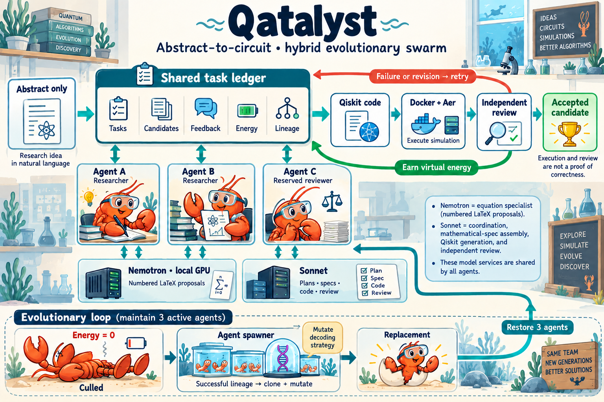

# Qatalyst: can a swarm rebuild a quantum algorithm from an abstract?

A research abstract tells you what an algorithm promises. Turning that promise into equations, working code, and a meaningful experiment takes considerably more work. For our hackathon, we built **Qatalyst** to explore how much of that gap AI agents can close with only the abstract as their starting evidence.

Our agents happen to be lobsters. Sometimes one ends up on its back.



Three agents share a task board containing candidate methods, feedback, virtual energy, and lineage. Two can develop implementations; a third stays outside implementation chains to provide independent review. When an agent runs out of energy, the spawner can replace it. If a successful strategy exists, the replacement inherits it with a small mutation; otherwise it explores a fresh strategy.

Underneath the claws is a hybrid model setup. A locally hosted, fine-tuned **Nemotron** proposes numbered LaTeX equations. **Sonnet** plans methods, assembles specifications, writes Qiskit code, and reviews the results. Generated code builds inside an isolated Docker worker, and Qiskit Aer simulates the circuit. These are cooperating agents on one host, sharing model services.

## A circuit that recovered the hidden values

One abstract describes identifying an affine Boolean function:

$$
f(x)=a\cdot x\oplus b.
$$

The task is to recover the hidden bit string $a$ and offset $b$. The swarm explored multiple approaches and selected a circuit combining an offset readout with a Bernstein–Vazirani step. Here is a small excerpt of its actual generated Qiskit code:

```python
# plain U_f: Z on q_i for a_i=1, global phase (-1)^b
for i in range(n):
    if bits[i] == 1:
        qc.z(data[i])
if b == 1:
    qc.global_phase += math.pi
for i in range(n):
    qc.h(data[i])
```

For `n=2`, `a=1`, and `b=1`, Aer returned **`101` in all 1,024 shots**: the reference bit encodes $b=1$, and the data bits encode $a=01$. Separate small-instance checks recovered both values in **28 out of 28 cases** across one to three data qubits. The whole swarm run took about **4.4 minutes**, with estimated paid usage of **$0.31**.

That result has boundaries. The circuit compiles explicit oracle parameters into gates and assumes controlled-phase-oracle access. It does not establish the paper’s black-box query complexity or its claims about incompletely defined functions. Attribution matters too: Sonnet rejected all eight native equation proposals and assembled the successful specification itself.

## A circuit that ran—and still needed revision

Another abstract concerned order finding with imperfect gates. The swarm generated a circuit for a small $N=15$ instance that built and simulated successfully. But the default-zero-input simulation concentrated on `00000000`, and review requested alignment of the required work-register initialization between the specification, circuit, and runner.

The swarm attempted repairs, recorded **two agent deaths and two replacements**, and reached its time limit without an approved candidate. The reviewer’s objection was not independently confirmed as a numerical counterexample, so this remains an unresolved result.

## What we are learning

Qatalyst makes the reconstruction process inspectable: proposals, code, execution, criticism, and replacement all leave evidence. The interesting question is how often that process produces the right algorithm. A circuit running in Aer, or receiving another agent’s approval, cannot answer that alone. Independent functional checks are the next essential layer.

Read the [full swarm examples](EXAMPLES.md) for abstracts, complete generated code, equations, and recorded outcomes, or explore the [architecture notes](docs/architecture.md).
