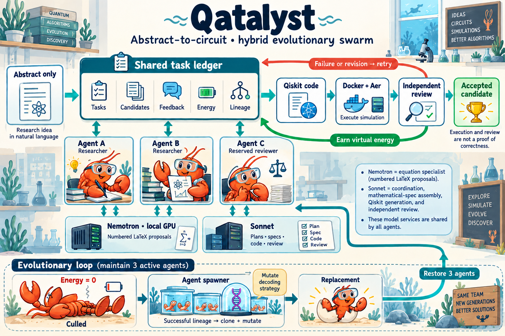

# Qatalyst: hybrid evolutionary swarm

This diagram describes the native-equation hybrid swarm implemented in
[native_swarm.py](../src/algo_discovery/native_swarm.py), configured by
[nemotron_native_swarm.yaml](../configs/systems/nemotron_native_swarm.yaml).

- **Three lobster agents:** two agents can assemble implementations; one is reserved
  outside implementation chains so independent review remains possible. Tasks are
  selected from the shared index, with validation and review prioritized over more
  proposal generation.
- **Shared task ledger:** a conceptual view of a2m's in-process task index,
  candidates, virtual-energy accounting, lineage, and saved event records. The
  current hybrid is a single-host logical swarm. This board is not a claim of a
  distributed database or heartbeat-based task recovery.
- **Shared model services:** Nemotron runs locally and predicts numbered LaTeX
  from the abstract using its training format. Sonnet plans methods, assembles
  specifications, generates Qiskit code, and reviews candidates. The agents share
  these services; each lobster does not load a separate GPU model.
- **Execution and review:** generated Python builds only in the isolated Docker
  worker. Trusted code reconstructs the returned circuit and runs Aer. A successful
  execution is provisional until a different agent reviews the implementation.
  Failed builds, abstentions and requests for revision create further work.
- **Reward:** progress rewards are deferred until execution and review pass.
  The reward is virtual energy, separate from actual API spending. Neither an
  execution pass nor a model's review proves algorithmic correctness.
- **Culling and replacement:** an energy-depleted lobster falls out of the active
  population. Where a successful donor exists, the spawner clones its strategy and
  mutates one decoding parameter. Otherwise it explores fresh strategies. The
  population is restored while execution budgets and replacement limits allow.

The drawing is an architectural illustration, not a snapshot of measured population
counts. A run can finish successfully without culling any agents. Call, time and
estimated API-spend limits can stop a run before a replacement is spawned.

See [real swarm examples](../EXAMPLES.md) and
[run configuration and training-format details](nemotron-swarm.md).
